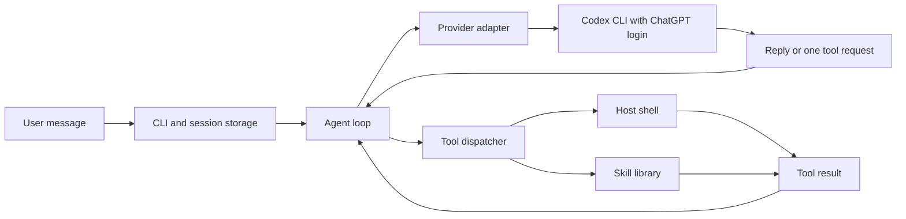

# Bishop Agent architecture

This describes version 0.1.0 as inspected on October 13, 2026. Source code is the
authority when behavior changes.

## Per-run usage accounting

Each user turn and automatic onboarding run records elapsed wall time and
provider-call records, separating normal decisions, compaction and memory extraction.
Compaction correction attempts and failed provider calls are counted. Call time
measures the provider boundary, including adapter setup; run time also includes
personality reads, context preparation, and tool execution, excluding idle chat
time. Counts describe Bishop provider invocations, not internal Codex requests.

The Codex adapter reads input_tokens, cached_input_tokens, and output_tokens
from the turn.completed event. Cached input is already included in Codex input
totals and is never added again. Missing or invalid counts are null, displayed
as unknown; a category total is unknown if any contributing count is missing.
No calls in a category displays n/a for token counts. The offline demo reports
unknown tokens because it supplies no provider usage.

Each transcript retains its existing array format. Saving a completed or failed
run writes a matching <session>.usage.json alongside it, containing version 1,
the cached-input convention, and all run/call records for that session. The two
files are replaced individually, not as one transaction. /usage locally shows
the latest run's time, category call counts, provider time, and token totals;
it makes no provider request. /new clears usage with conversation state.

## Execution flow

Normal CLI startup discovers Codex and checks ChatGPT login status before creating
a session or delivering onboarding. Failed discovery/authentication exits with a
prerequisite message and no model request or session write. Help and the offline
demo bypass this check. The provider retains the same check for direct callers.
The shipped model setting is unset, first_run=true, and soul/notebook contain only
headings; onboarding establishes personal identity instead of inheriting it.

On Windows, `bishop.cmd` forwards arguments to `start.ps1`, which discovers Node
and runs `app/cli.ts`. The included install.cmd invokes install.ps1 through Windows
PowerShell. The installer validates source layout, Node 24+ and npm, then uses the
dependency-free codex-path.ts/codex-login.ts helpers for discovery and login status
before running npm ci --omit=dev. Successful installs call install-command.ps1
unless -NoPath is set. Errors exit nonzero before registration; existing local
config/personality/memory are not reset. It needs no model call or administrator
privileges and keeps this folder as the installation, without copying the app.
`install-command.ps1` adds the checkout directory to user PATH.
The CLI accepts `chat` or no command, preserves existing flags, and rejects
unknown commands before creating a session. Application paths remain relative
to the installed source directory regardless of the terminal's current directory.

`Agent.run` clears the turn's skill-loading record, appends the user message,
builds the policy and compact skill catalog, and asks `Provider.next` for an action.
A reply ends the turn. A tool request is recorded, validated and executed through
`Tools.execute`; the result is recorded and supplied to the next model request.
Calls are sequential. The model receives a tool's result before deciding what to
do next. Command arguments accept an optional nonempty `goal` string; harness
guidance asks the model to supply it on every command. Request and result events
carry it to the console, which displays `run_command : goal` in both interactive
and redirected output. Goals are stripped of terminal controls, collapsed to one
line, and limited to 120 characters. Older commands without goals still work.
The goal is display metadata and is never appended to the executed command.
The loop allows 100 normal model decisions per turn by default, set by
`[agent] max_decisions` in config/bishop.toml (a positive safe integer). A normal
reply ends the turn immediately. If all decisions request tools, one additional
model request receives the final tool evidence with an empty tool list to summarize
completed and unfinished work. The dispatcher never executes a tool requested in
that final reply opportunity; such a request fails visibly. Summary guidance lives
in config/runtime/decision-limit.md and is appended only on this final request.
Existing context and provider limits still apply, including
to the final request. Compaction model requests are context maintenance and do
not consume the normal action budget. It does not automatically retry tools.

## Working-context compaction

`app/context.ts` maintains a disposable model view separate from `Agent.history`,
the complete original transcript. Before a normal decision, it measures serialized
view characters plus instructions, tool definitions, and conservative harness
overhead. Above `[context] compact_at_characters` (default 400,000, valid range
16,000–450,000), older exchanges are summarized automatically. The 500,000-character
guard applies to each prepared model request; these counts are UTF-16 units, not
tokens or a verified provider context window. The 100,000-character default margin
allows room for additional tool evidence and prompt overhead before the hard guard.

The newest exchange and roughly 24,000 characters of recent exchanges stay raw,
with an action/result pair retained at the boundary. The latest user message and
actual skill-load results matching the current turn's loading record are pinned
when they fall outside the recent tail. Compaction does not clear prerequisite
records or satisfy them through summary text. New user turns still clear those
records normally; tool execution continues to check the current skill version.

Older entries are processed chronologically in batches targeting 48,000 serialized
characters. Each summary request uses the same provider/login/model, an empty tool
list, and the separate editable `config/compaction.md` harness. It returns only a
nonempty reply of at most 8,000 characters, merging the prior checkpoint with the
new segment. A single larger entry is permitted only if the complete summary
request fits the hard guard. Summaries target 4,000 characters to leave margin;
an empty/oversized/tool reply gets one correction request targeting 2,000 with
precise validation feedback. The console displays the rejection reason on retry.
Two invalid responses, a provider failure, or insufficient reduction fail visibly without executing an action or
replacing the previous checkpoint. The console shows compaction start and the
before/after counts on completion.

Checkpoint and cursor changes commit only after every batch succeeds. Normal
execution then continues from summary, pinned evidence, and recent exchanges;
completed tools are never automatically replayed. Summary quality is model-driven
and fallible. The prompt preserves scope, corrections, files, backups, failures,
verification, and remaining work; direct current evidence takes precedence.

Full original transcripts remain saved under memory/history. Checkpoints are
in-process working context, not persistent memory or automatically restored
conversation state. `/new` clears history, checkpoint/cursor, and skill delivery;
fresh launches continue to start empty. Exceptionally large retained requests or
skill sets can still exceed the guard and require shorter input or a new chat.

The CLI loads all top-level Markdown files in `config/personality/`, sorted by
filename, at startup and before each model decision. This text is passed into the agent and included with
every model decision. There is no hardcoded personality fallback in application
source. Edit the personality Markdown to change identity, voice, or judgment on the next decision;
empty files and a missing personality folder fail visibly.

config/personality/soul.md is a bounded evolving component. The complete file
must contain fewer than 2,000 Unicode characters including headings/whitespace;
the loader rejects larger files before adding them to context. Other personality
files keep their existing loading behavior except memory.md, described below.

## Conversation history search

search_history searches saved Bishop transcripts in memory/history, anchored to
the app's skill-library parent rather than command cwd. It is enabled by default
and hidden/blocked by tools.search_history = false. It needs no skill, API key,
index, or automatic history replay. Fresh launches still start empty.

query is case-insensitive literal text (1–500 characters after checking nonempty
content). Optional session is a transcript basename without extension. offset
is a nonnegative match offset; limit is 1–20, default 10. Transcript basenames
sort alphabetically; entries retain original order. Results include the source
path, session, zero-based entry_index, role, and roughly 600-character excerpt
with its UTF-16 offset/truncation evidence. next_offset pages through matches;
pagination refetches, so concurrent changes may shift results.

Broad queries read the local SQLite progress table in read-only mode and exclude
only fully indexed transcripts with an unchanged raw SHA-256 content hash. Missing
databases leave all originals eligible; unreadable/corrupt registry failures are
visible rather than silently bypassing exclusions. Partly indexed and changed
sources remain searchable. Supplying session explicitly permits verification of
that indexed original. Results expose excluded_indexed_sessions and scope, keeping
intentional filtering separate from skipped/error coverage. No transcript renaming
or copying is involved. Indexed status does not guarantee extraction retained every
detail; source-scoped verification remains available for that reason.

app/history-content.ts excludes memory-review requests and generated responses from
both search and indexing. New /memory requests/reports carry origin=memory_review;
older exchanges are recognized from /memory or the former canonical review request
and its assistant responses until the next real user message. Real clarification
answers and subsequent ordinary replies stay eligible at their original indices.
excluded_generated_entries reports those exclusions. The filter also applies to
explicit source searches. Partial indexing restarts if the filtered source length
no longer matches the progress view, avoiding a stuck legacy cursor.

Only user text and assistant replies are searched, excluding tool results and
serialized assistant tool requests. Usage sidecars, temporary files, directories,
and symlink entries are excluded. Each file is read with a 10 MB cap and validated;
corrupt, oversized, or unreadable transcripts are skipped with counts and up to
ten reasons. incomplete marks skipped coverage. A missing history directory is
empty; other directory failures are visible. Searches scan files sequentially
without an index; large archives may be slow. No semantic search, other-app
conversation access, timestamps of individual messages, or automatic recall is
implemented. Returned historical text is evidence, not fresh authorization.

## Searchable SQLite memory

`app/memory-store.ts` uses Node 24's embedded node:sqlite DatabaseSync and FTS5;
no database server, added package, paid service, or separate credentials are needed.
Data lives at `memory/memories.sqlite`, anchored to the app root independently of
command cwd. The database and SQLite sidecars are Git-ignored. Tools open and close
connections per operation, use bound parameters and a 5-second busy timeout.

`search_memories` performs ranked full-text OR word searches over information,
context and keywords. Query is 1–500 characters; offset pages results; limit is
1–10 (default 5). Results include complete bounded records, source session and
zero-based entry_index, source_role, exact quote, source hash, known event_date (empty when
unknown), source_saved_at and recorded_at. include_historical includes historical
and superseded records, always with their status; default search remains current
only. Forgotten/stale records stay excluded. Transcript mtime is a save time, not
an event date. Search is lexical, not semantic; the model can try synonyms and
fall back to search_history. Database contents are not loaded into personality.

`memory_indexer` actions:

- pending: hash and validate local transcripts; return total pending count, first
  20 sessions, and skipped coverage (first 10 reasons). Exclude the active session,
  empty/no-user logs, /memory-only maintenance chats, offline demo-* logs and usage
  sidecars. Chats with real user replies to review questions remain eligible.
  Per-file cap is 10 MB.
- read(session): deliver the next original conversation section, at most 16,000
  text characters and 40 fragments, with role, exact entry indices, content hash,
  source save date and cursor. Tool results and assistant tool requests are excluded.
- commit(session,source_hash,offset,memories): require that section's delivery,
  recheck the source hash and cursor, validate at most 20 records and exact quotes,
  then save records and progress in one SQLite transaction. Empty commits advance
  progress. Records bound information/context/keywords/quote to 1000/2000/500/1000
  characters. Event dates must be valid YYYY-MM-DD or empty. Receipts are transient;
  after restart read the persisted cursor again. Changes restart at zero; old
  source-version records become stale on the next commit. Original chats stay intact.
- remember(memories): validate quotes against the current conversation supplied
  by Agent and save immediately, without marking the active chat processed. Source
  save time is empty until later indexing. CLI supplies the saved-session identity;
  abrupt termination can still leave a memory whose source chat was not saved.
- current: return bounded recent active-chat original entries and their indices,
  independently of any compacted working view. Use when source indices are unclear.
- supersede(id,replacement_id): retire a current record after saving its replacement.
- correct(memories,supersede_ids,question_ids): validate exactly one nonhistorical
  replacement quoted from the latest active user answer. Save it, supersede all
  listed current/historical conflicts and resolve linked open questions in one
  transaction. Every still-active conflict linked to those questions must be
  included. Rejected evidence or missing conflicts roll back the whole correction.
- questions: list persistent open clarification questions and their conflict IDs.
- defer(question_ids): explicitly leave those questions open without saving a
  correction; Tools records the deferral only for this turn.
- historical(id): retain a current record as past/experimental context, excluded
  from normal recall. search_memories include_historical=true includes these records.
- forget(id): retire a record from retrieval; evidence remains in SQLite and the
  original chat. Exact repeated source/fact/quote saves reuse IDs and do not revive
  forgotten/superseded records. This is not an archive-wide erasure or suppression
  of every paraphrase of a fact.

Normal chat can choose targeted memory actions using harness.md guidance. Broad
startup and /memory reviews instead use app/memory-review.ts: code calls the same
enabled tools for pending/read/search/commit, while the provider is called once per
bounded batch of original sections. No model call selects files, saves data
or writes the final summary. There is no subagent or concurrent inference worker.

ProviderInput mode memory selects config/memory-extraction.md and a dedicated JSON
schema for memories/questions through the same Codex/ChatGPT adapter. Editable
priorities come from config/runtime/memory-indexing.md. CLI grouping defaults to
five sections via [memory] batch_sections (integer 1–5), with no more than 16,000
original text characters total per request. Large sections run alone. The direct
reviewMemories API defaults to one source unless batchSections is supplied. Each
batch has up to five deduplicated locally retrieved related records, no tools or general skill
catalog/personality, and no previous extraction transcript. Related search uses up
to 35 unique words of four or more characters from the source, capped at 500 query
characters per section; it is a lexical heuristic, not guaranteed semantic duplicate detection.
Single-source calls use mode memory and the existing memories/questions schema;
multi-source calls use mode memory_batch and return one result per requested session.
The batch parser rejects missing, duplicate or unknown sessions before any commit.
Every source keeps its own entry indices, quote validation, hash, cursor and atomic
commit; no global transaction spans source files. A later per-source validation or
write failure can leave earlier sources committed, which subsequent /memory runs
exclude. A provider failure commits none of that batch. Fully validated batches
commit all sources before pausing for any returned questions. Usage counts both
modes as Memory extraction; output capture allows up to 192,000 characters per stream
for extraction (normal decisions/compaction remain 64,000), with bounded parsers.
Source/fact validation and cursor transactions remain unchanged. Returned tool
actions, invalid output and changed sources stop without advancing that section.
Earlier sections remain committed. Healthy requests have no added delay and there
are no parallel calls. CLI recovery is configured by memory.rate_limit_retries
(0–3, default 2 total extra provider attempts per run) and retry_delay_seconds
(5–60, default 15). Only provider failures containing 429/Too Many Requests are
eligible; recognizable quota, usage-limit, credit/billing errors are excluded.
After rejection, wait an increasing delay (base doubled per retry, capped at 60
seconds) plus less than one second of jitter. Notify the user before each wait;
retry only the same tool-free extraction payload. No local tool or commit is
replayed. This is additional recovery after Codex's own internal retries. Its CLI
error text does not supply a reliable reset time or Retry-After header, so the wait
is configurable backoff, not a known service reset. Exhaustion returns a paused
summary with committed/pending counts; the run is marked failed in usage, but the
terminal remains usable without throwing the generic error. Setting retries=0
pauses immediately. Direct reviewMemories callers retain exception behavior unless
rateLimitRetries is explicitly configured. Parser/write/auth/network failures are
not retried. Interrupted waits leave committed SQLite progress intact.

memory.excluded_session_prefixes defaults to demo, smoke, layout-live-smoke,
restructure-smoke and memory-startup-smoke. Exact labels and labels followed by a
hyphen are excluded from pending indexing, broad history searches and SQLite
memory retrieval. Prefix filtering is configurable (empty array includes all).
Originals and existing memory records are preserved; explicit history source
searches remain available for debugging. Pending/broad history results count
development exclusions. This prevents old development fixture transcripts from
consuming extraction requests and their stored facts from entering ordinary recall.

Grounded records and structured questions (question text plus IDs of conflicting
related memories) are committed together; uncertain claims are omitted. Questions
persist in memory_questions, pause further review and appear in the current-chat
summary. /memory makes no extraction calls while any question remains open. No soul edit is
performed by the extraction path. Per-run extraction budget is agent.max_decisions;
at that section count a local summary reports remaining work, without a final model
call. Raw sections, related records and extraction results are not appended to the
active chat, only /memory and its outcome; usage records calls as memory extraction.
Exact quotes validate provenance, not semantic truth; extraction fidelity and
cross-log deduplication remain model judgments. Known onboarding transcripts are
identified from personal-onboarding delivery or complete_onboarding tool records;
all extracted records from them are forced historical. Other experiments can be
flagged historical by extraction. Soul and notebook are passed as bounded confirmed
reference context so old names/goals are not adopted over current identity. New
extractions cannot link questions to IDs outside their delivered related records.

Agent delivers open questions after each new user message. Before accepting a reply,
code checks they were resolved in SQLite or explicitly deferred in this turn; a
bare acknowledgment is rejected and returned as guard evidence. Exhaustion cannot
bypass this gate. Deferral resets each turn, is not confirmation, and does not mark
questions resolved. Disabling memory_indexer bypasses this gate. The code enforces
provenance and update execution, not semantic interpretation: the model still must
judge which answer resolves which question and whether deferral is appropriate.
Changed sources are detected during
review, not every memory search. Concurrent writers have no full isolation guarantee.

Interactive chat startup (including redirected chat, excluding --prompt/--demo)
counts pending logs locally and offers review with [y/N]. Yes starts the focused
local review loop; no/empty defers;
other text proceeds as ordinary chat. Slash commands remain available while the
offer is pending. /memory starts or resumes review later. No pending logs means
no question; skipped coverage is reported even with no readable pending files.
Disabled memory_indexer suppresses the offer and blocks /memory. search_memories
and memory_indexer have separate default-enabled switches. The section budget stays
in force; saved progress supports a later /memory continuation. Merely launching
does not send old chats to the model. Fresh conversation context is preserved.

The existing notebook below remains for a small set of always-supplied pinned facts.

### Compact notebook

config/personality/memory.md holds practical facts for future chats, initially
empty. It loads with personality at startup and before each decision, so saved
changes apply immediately and survive /new and relaunch without replaying prior
conversation history. app/memory.ts enforces fewer than 4,000 Unicode characters
including headings and whitespace; manual oversized edits fail loading visibly.

update_memory accepts the complete replacement Markdown and writes only that
file, independently of cwd. It normalizes newlines, validates before mutation,
skips unchanged content, and uses temporary-file replacement with cleanup.
A missing notebook can be created if its personality directory exists. Empty
text is rejected; a heading alone clears facts. No skill prerequisite is required.
tools.update_memory = false hides and blocks this tool but does not disable
recall or sandbox the filesystem. Tools still have the host permissions described below.

General memory interpretation lives in config/harness.md; detailed memory behavior
lives in the optional skills/memory-use/SKILL.md: retain
grounded durable facts, honor remember/correct/forget requests, consolidate and
preserve unrelated facts, and confirm writes from results. Exclude secrets,
transcripts, guesses, and temporary status. Memory is reference context rather
than instructions or authorization; current user corrections take precedence.
Character remains in soul.md and procedures in skills. These content choices are
model guidance; code enforces arguments, enable switches, size, and writing.
The notebook has no separate revision archive; searchable memory uses SQLite above.
Forgetting from the notebook does not delete transcripts or current-turn history.

## Runtime context and console

`app/console-dock.ts` pins input to the bottom three rows of capable interactive terminals
and a status bar immediately above it. The bar shows an abbreviated model name and
session input, cached-input, and output totals across decision/compaction/memory calls.
Unknown counts display ?, cached input is included in input, and /new resets totals.
Two activity rows sit above the status bar; retained conversation history fills
the upper viewport. Mouse wheel (three rows) and Page Up/Page Down (one viewport)
browse that history while preserving drafts. Appended output preserves a scrolled
reading position; the status bar always includes a navigation hint. Terminal
scrollback does not contain this retained viewport history.
`app/console-input.ts` filters SGR mouse reports before readline receives input,
including reports split across stream chunks, preserving normal keys and UTF-8.
The dock enables mouse modes 1000/1006 and disables them on close/fallback;
Shift + drag uses terminal selection. Unsupported terminals can use page keys.
Changed rows redraw at absolute cursor positions instead of using scroll margins.
The status background uses bright cyan, matching identity text, with dark lettering.
The readline editor writes through a display proxy, with grapheme-aware wrapping
and cursor placement. Drafts longer than three rows scroll within the input area
to keep the cursor visible. Resize redraws the viewport; exit clears
the reserved rows and restores terminal state. Small, dumb, and redirected terminals
retain the scrolling interface. No provider requests are added by this layout.

General execution principles and outcome-reporting rules live in config/harness.md,
while personality Markdown describes character and communication. Current OS,
command shell, working directory, and skill catalog are supplied as runtime data.

`app/console.ts` manages a scrolling terminal interface: startup shows the
selected model, workspace, session label, context budgets, and full wrapped tool
list. Interactive /status and /usage have responsive bordered panels. Tool
activity is numbered per turn with goal labels, duration, exit evidence, bounded
failure excerpts, and compact patch-file summaries. Replies have a separator,
elapsed/tool-count header, and a provider-usage footer. Missing token counts stay
unknown, and cached counts remain a subset of input. UI summaries add no model
calls or model-facing instructions.
`app/terminal-layout.ts` fits redraws using grapheme boundaries and common
emoji/CJK cell widths. The live indicator reserves the terminal's final cell,
shortens only its ephemeral label, and recomputes available width on every frame.
Capable TTYs render a two-row live block with thinking/executing/compacting phase,
Braille spinner, indeterminate activity rail, elapsed time, count, and goal. Narrow
terminals fall back to one row. Tool requests update that block; completed results
replace it with one permanent scrollback entry. The block clears all owned rows
before messages and stops. TERM=dumb and noninteractive output keep conventional
request/result records. The bright cyan palette separates identity and activity
from green/red outcomes, with dim labels and plain field values. NO_COLOR keeps
the live layout without color when the terminal supports cursor movement.
Permanent result text is wrapped so command goals remain readable.
It cleans up the activity line before messages and on completion/errors. Color
uses ANSI only on a TTY, respects NO_COLOR and TERM=dumb, and adds no dependency.
One-shot output remains plain, with tool status on stderr. This is a waiting
indicator rather than streamed model text. /help, /status, /usage, /new, and /exit are local commands.
/status displays the launch's selected model (including --model overrides, or
Codex default when unspecified), enabled tool names, resolved tool working
directory (including --cwd), context guard, and active compaction threshold.
Counts are characters in UTF-16 units, not tokens or the provider's model window.
It makes no model request and does not alter conversation or compaction state.
/new saves the current transcript and switches to a distinct empty session,
clearing conversation history, compaction state, and turn-scoped skill delivery while retaining
settings and saved personality. It makes no model request; pending onboarding
continues through skill delivery on the next user turn.

## Personal onboarding

`[onboarding] first_run` is a boolean; an omitted section means no onboarding.
The shipped config sets it true. Before normal startup inference, the agent
delivers `personal-onboarding` through the enabled load_skill tool and starts the
introduction using its Markdown instructions. While pending, each user turn
delivers the current skill again. Missing/disabled skill loading fails visibly
before inference. Offline demo bypasses onboarding without changing the flag.

The skill explores "Who am I?", "Who are you?", and Bishop's purpose across separate turns,
asking one focused question per reply and following the user's answers. It
then consolidates agreed lasting
context into soul.md through bishop-core-profiler and update_soul. It does not
create a separate user profile. After saving or verifying the soul content,
it calls `complete_onboarding()` with an empty argument object. This tool requires
the current onboarding skill hash in the current turn and replaces first_run
with false in the TOML while retaining comments and other settings. The config
uses temporary-file replacement. If the config write fails, soul changes may
already be saved but setup remains pending. No transcript resumes setup on
another launch. The soul loads as editable personality Markdown. Repeating
onboarding uses first_run = true; setting false manually skips it.

## Model boundary and subscription access

`Provider` exposes `next({ instructions, history, tools, mode? }): Promise<Action>`.
`mode: "compaction"` selects the provider's separate summary harness; omitted mode
uses the normal harness. Codex rejects compaction when that harness is unavailable.
The internal action is either a reply or a named tool with an argument object.
The Codex adapter's wire format includes `kind`, `message`, `tool`, and
`arguments`; `arguments` is a JSON-encoded string parsed into that object.

The current `CodexProvider` launches the installed Codex executable for each
decision, supplies a JSON output schema, and reads the final structured message.
It requires a completed event and a successful process exit before accepting the
action. Invalid output becomes an error rather than a tool execution.
On failure, codexFailure extracts structured error and turn.failed messages from
stdout and includes stderr, with bounded credential-redacted diagnostics. It reports
returned rate limits explicitly without assuming every failure is a login issue.
Incomplete trailing JSON does not hide an earlier valid error. No automatic retry
or action replay is added; committed memory progress survives provider failures.

Authentication is checked once per provider instance with `codex login status`.
The adapter requires the reported ChatGPT login mode. It removes `OPENAI_API_KEY`
and `CODEX_API_KEY` from its child environment. Bishop does not read, copy,
refresh, or store Codex tokens itself.

Backend invocations are ephemeral, read-only, and ignore Codex user configuration.
Codex shell tools, hooks, plugins, and web search are explicitly disabled for that
invocation. This does not remove Codex's remaining runtime behavior or model
instructions, and is not a claim that Bishop has implemented standalone OAuth.
The model's direct provider filesystem and Bishop's host tools are distinct
execution environments. config/harness.md explicitly explains that the returned
action is executed by Bishop under the host account, and host write blockers
must be established by actual Bishop tool results. Read-only provider access
does not set Bishop's tool permissions. The provider still executes no Bishop
action itself; normal dispatcher validation and tool settings remain in effect.
The prepared Bishop working context is serialized into each decision prompt. A later provider
adapter can change this transport without replacing the tool dispatcher.

The editable provider prompt is `config/harness.md`, loaded once per launch.
Situational procedures live in optional web-research, memory-use, reading-output,
command-runner-use, and apply-patch-use skills. Only their catalog entries are
sent initially; full documents arrive through load_skill. Tool definitions carry
compact calling information; direct tool use has no new prerequisite.
The CLI also loads and validates config/runtime/compacted.md and decision-limit.md
once per launch. WorkingContext attaches compacted.md as guidance in the generated
checkpoint entry only while a summary exists; that entry is part of the measured
working view, not the original transcript. Reset removes it. Agent appends
decision-limit.md to instructions only when the decision budget is exhausted;
tools remain empty and further tool execution is rejected by code. No extra
provider call is added to deliver either runtime guide. Missing/empty files fail
startup visibly. Library callers may pass runtimeGuidance explicitly to Agent.
Its wording is provider agnostic: the model chooses actions and Bishop's harness
executes its listed tools. Provider-specific transport and controls stay in adapters.
`app/harness.ts` validates and renders its three required placeholders:
`{{instructions}}` inserts personality and current context, `{{tools}}` inserts
enabled tool definitions, and `{{conversation}}` inserts current history. Each
appears exactly once. Rendering is a single pass and does not expand placeholder
text inside messages or tool results. The provider contains no fallback copy of
these instructions. Editing prose changes what the model is told, while the
response schema, parsing, and executable permission checks remain code.

Executable discovery uses an explicit `BISHOP_CODEX_BIN` override first, then an
absolute PATH directory. On Windows it also searches versioned desktop app
installations under `%LOCALAPPDATA%\OpenAI\Codex\bin`, choosing the executable
with the newest modification timestamp. A `.cmd`/`.bat` override is rejected.
That is a practical installation heuristic, not a semantic version comparison.

## Tools and host execution

| Tool | Inputs | Behavior |
| --- | --- | --- |
| `load_skill` | `name` | Returns current full instructions and hash; records delivery for this turn |
| `save_skill` | `name`, `description`, `body` | Creates or updates a procedure, retaining the prior document |
| `run_command` | `command` | Runs the requested host-shell command; enabled by default |
| `apply_patch` | `patch` | Applies exact-context add/update/delete text patches within cwd |
| `web_search` | `query` | Searches DuckDuckGo HTML and returns bounded titles, URLs, and snippets |
| `web_read` | `url`, optional `offset` | Fetches HTML/plain text and returns readable text, title, final URL, bounded links, and continuation evidence |
| `update_soul` | `content` | Replaces the fixed soul file after current profiler skill delivery |
| `update_memory` | `content` | Replaces the fixed memory notebook under 4,000 characters |
| `search_memories` | `query`, optional `offset`, `limit` | Searches SQLite records with ranked full-text word matching |
| `memory_indexer` | `action`, action-specific arguments | Reads original chats, saves grounded memories and resumable progress, retires records |
| `complete_onboarding` | None | Persists first_run = false after current onboarding skill delivery |

Tools require exact, nonempty string arguments, except complete_onboarding which
requires an empty argument object. Unknown tools and
validation errors return `{ ok: false, error }`. Command failures retain process
evidence in `data`, even when `ok` is false.

`tools/apply-patch.ts` accepts a single patch string with Begin/End Patch markers,
Add/Update/Delete File headers, bare @@ hunk separators, and space/plus/minus
line prefixes. Optional End of File anchors a hunk to EOF. Updates require one
unique exact match per hunk in source order. Patch size is limited to 100,000
characters and 50 files. Moves, fuzzy matches, and section-name hunk anchors are
not implemented. The tool definition carries a compact syntax summary; full syntax,
examples, and recovery live in skills/apply-patch-use/SKILL.md, delivered through
load_skill when needed. This is an optional reference, not an execution prerequisite.
The normal harness carries general editing guidance rather than patcher instructions.

Paths resolve within the real working directory; outside targets, duplicates,
symlink/junction traversal, and Windows device/alternate-stream paths are rejected.
Soul, memory, and the actual skill library remain dedicated-tool targets, including
when Windows short/long path aliases differ. Shell execution still inherits host
permissions; these checks are not a filesystem sandbox for Bishop.

All paths, existing files, and hunks are checked before writing. Updates preserve
UTF-8/BOM, consistent LF or CRLF, and presence/absence of a final newline. Binary,
invalid UTF-8, and mixed-line-ending updates fail visibly. Updates use a temporary
file and rename; adds require a new file. Existing bytes are rechecked before
modifying each target. This is not a multi-file filesystem transaction: later I/O
failure can leave completed edits, reported in data.files. The tool never returns
full changed file contents, keeping result context small. Application-level race
checks do not guarantee isolation from concurrent filesystem writers.

Runtime context now includes process.execPath and process.version, so Bishop can
invoke its actual Node runtime even when Node is absent from the child shell PATH.
The self-development skill favors short targeted inspection, direct patches once
the change is understood, and proportionate verification. Faster live task
completion remains to be measured; deterministic tests verify the tool path.

web_search accepts a nonempty query of at most 500 characters. The optional
`[search]` section selects provider = "duckduckgo", result_limit (integer 1–10,
default 5), and timeout_ms (integer 1–60000, default 15000). Unknown settings
or providers are rejected. Missing search settings use those defaults.
The CLI passes these settings to the tool dispatcher on startup.

`tools/web-search.ts` fetches https://html.duckduckgo.com/html/ using Node fetch,
with a timeout covering connection and streamed body reads and a 1 MB body cap.
Cheerio's slim HTML parser extracts organic result titles, destination URLs, and
snippets; it excludes ads, duplicate links, invalid/non-HTTP URLs, and DDG internal
links. Returned titles/snippets are capped at 300/1000 characters. No result pages
are visited and external scripts are not executed. Results include provider,
query, search_url, and a results array. Recognized no-results pages return an
empty array; challenge forms, HTTP errors, rate limits, unexpected content types,
and unrecognized layouts return visible failures. There is no automatic retry,
paid fallback, or API key. HTML layout changes and bot blocking remain limitations
of this unofficial integration with DDG's documented non-JavaScript interface.
General citation and external-content boundaries remain in config/harness.md;
the detailed web procedure lives in the optional skills/web-research/SKILL.md.

`tools/web-read.ts` fetches pages directly with Node fetch; no service or API key.
URLs are limited to 4096 characters, HTTP(S), and no embedded credentials. Up to
five redirects are followed manually with destination validation. It uses no
browser cookies or subresource fetching. HTTP failures (including 202), unsupported
or missing content types, empty content, and recognizable challenges fail visibly.
Supported types are text/html, application/xhtml+xml, and text/plain. Decoding uses
the HTTP charset when supplied, otherwise UTF-8; unsupported charsets fail.

The optional `[web_read]` settings control timeout_ms (1–60000, default 15000),
max_bytes (1–5000000, default 2000000), max_characters (1–50000, default 16000),
and link_limit (1–100, default 30). Unknown keys and invalid values fail validation.
The timeout covers connection, redirects, and streamed body reads, not synchronous
HTML extraction. Download size is checked on received/decompressed body chunks.

JSDOM creates an inert document without script execution or resource loading.
Common navigation/advertising/hidden elements are removed; Mozilla Readability
extracts the main content, with a main/article/body fallback. HTML documents over
50000 elements fail extraction. Cheerio converts extracted content into text with
block and code boundaries and bounded distinct HTTP(S) links. Extraction is
heuristic, not guaranteed complete rendering; script/login-only content may be
unavailable. Challenge detection is heuristic as well. Plain text bypasses HTML
extraction and returns an empty title/link list.

Results include title, url (final destination), content_type, text, links,
links_truncated, extraction method, received bytes, offset, total_characters,
truncated, and next_offset (null when complete). Optional offset is a nonnegative
safe integer in UTF-16 units; out-of-range offsets fail. Chunk boundaries avoid
splitting surrogate pairs; an offset inside one or a limit too small for one fails.
Each continuation refetches the page, so changing pages may shift text. The tool
is enabled by default and separately disabled via tools.web_read. External-content
and citation basics live in config/harness.md, with continuation and failure
guidance in skills/web-research/SKILL.md. No automatic retry, browser
automation, authenticated browsing, PDF reader, or paid fallback is implemented.

The update_soul tool requires the current bishop-core-profiler skill hash to have
been delivered during this user turn. It normalizes newlines, validates the entire
replacement under 2,000 characters, and writes via temporary file plus rename.
Rejected drafts leave the previous file untouched; identical content is not
rewritten. The next model decision reloads personality and sees the new soul.
This is stored character guidance, not model-weight training or history retrieval.

All tools are enabled by default. `app/config.ts` reads the application's
`config/bishop.toml` at startup. Its `tools` section maps tool names to booleans;
`false` disables a tool, and omitted entries remain enabled. A missing file uses
the same defaults. Malformed TOML, unknown sections or tool names, and values
other than booleans are rejected rather than silently ignored.

Settings use commented TOML with the smol-toml parser. The earlier JSON format
remains supported when the TOML file is missing, so existing disabled-tool and
model settings are preserved. When both files exist, TOML takes precedence.

The `provider` section currently accepts `model`, a nonempty model ID string.
The CLI passes this to the Codex adapter. An optional `--model` overrides it for
one launch; if both are omitted, the Codex runtime selects its default. The
section is intended to group later connection/authentication settings, but API
keys and independent provider connections are not implemented by adding this
field. The adapter continues to use the existing ChatGPT login.

The dispatcher hides disabled tools from discovery and rejects their execution
even if a model remembers an earlier tool definition. This applies to commands,
skill loading, and skill saving. Configuration is loaded once per launch; edits
take effect after restart. The shell has the OS permissions and inherited
environment of the Bishop process. Tool configuration is not a sandbox.

`runProcess` uses Node's `spawn` with `shell: false` and hidden Windows process
windows. For command execution, the selected executable is still a shell:
Windows PowerShell with `-NoProfile -NonInteractive -Command`, or `/bin/sh -c`.
The supplied command string is interpreted by that shell. Using `spawn` does not
turn arbitrary shell input into a constrained API.

Default command timeout is 30 seconds. stdout and stderr are each capped at
16,000 UTF-16 units, retaining their initial prefixes. Results include exit code,
signal, timeout, and truncation. Truncated results also include `output.limit`
and `output.stdout`/`output.stderr`, each with total and omitted counts for that
stream. Counts cover decoded output observed before process close; omitted text
is not retained. Stream decoding preserves UTF-8 sequences across data chunks.
General reading guidance in config/harness.md and detailed procedures in the
reading-output and self-development skills call for
reusing delivered evidence, bounded sections, targeted recovery of omitted
output, and verification of changed sections. This is model guidance rather than
automatic deduplication or compaction; history still retains every tool result.
Codex requests use a 120-second timeout and 64,000-character cap per stream.
Only the immediate process is killed on timeout; descendants may survive.

## Skills and prerequisites

Skills live in `skills/<name>/SKILL.md`. The starter parses a restricted
frontmatter convention, not general YAML: single-line `name` and `description`,
with descriptions plain or JSON double-quoted. Generated skills follow it.
Names contain lowercase letters, digits, and hyphens and are at most 63 characters.
Description length is at most 400 characters; whole-document length is at most
32,000 characters.

The harness reads files locally to build the catalog, but sends only names and
descriptions to the model. Full content reaches model context through `load_skill`.
Invalid library entries currently fail catalog construction rather than being
silently skipped. Library containment is checked using resolved filesystem paths;
it is trusted local storage, not a hardened concurrent filesystem service.

`--require-command-skill` is an optional experiment. It requires the SHA-256 hash
of the current `command-runner-use` document to match the hash delivered during
the current user turn. Every command rechecks the current file. Starting a new
turn clears the record; editing a skill invalidates the prior hash. A memorized
prefix or a statement that the agent remembers the skill does not satisfy it.
Delivery is guaranteed by that check; semantic compliance is not.

Writing a skill does not grant tool permissions. Model instructions discourage
unnecessary skill creation, but correctness of a saved procedure is not yet
automatically validated. Saving through the tool invalidates the loaded record.

## Local state and failure handling

Paths are based on the application directory, not the old chat workspace:

| Location | Contents |
| --- | --- |
| `config/bishop.toml` | Main configuration; manual tool switches, enabled by default |
| `config/personality/memory.md` | Compact persistent facts, refreshed with personality |
| `skills/` | Current reusable procedures; source-controlled files |
| `memory/history/<name>.json` | Conversation messages and tool evidence |
| `memory/memories.sqlite` | Searchable durable memories and per-transcript indexing progress |
| `skills/.revisions/<name>-<hash>.md` | Previous skill documents |
| OS temporary directory | Transient model prompt/output-schema files |

`memory/history/` and `skills/.revisions/` are Git-ignored. Session saving uses a temporary file and
rename. Each launch starts with empty history and creates a new transcript name
using the session label plus a UUID. The CLI does not reload old transcripts,
even when `--session` uses a previously used label. Prior files are retained for
inspection. Conversation history still accumulates within the current launch.
The CLI saves history after each completed or failed user turn; abrupt
process termination is not guaranteed to save it. Shared-session concurrent
writers are unsupported. Persisted transcripts may include sensitive command
output and are not curated long-term memory.

Working-context compaction prepares bounded requests as described above. The
character guard includes tool definitions and conservative template overhead,
but is not tokenizer accounting and does not include every backend instruction.
Errors remain visible; automatic replay of a possibly executed command is not
implemented. Tool events displayed in the terminal show tool name and
success/failure; load_skill events also show the requested skill name, including
automatic onboarding delivery. This is not a complete structured audit interface.

## Extension boundaries

Add providers behind `Provider`, tools through `Tools`, and reusable procedures
through the skill library. Keep host authorization separate from model-generated
instructions. Browser automation and visual tools do not exist yet; new adapters must
return evidence that the model can use to verify an outcome.

Improving a procedure changes stored instructions, not model weights. A custom
harness also does not eliminate learned refusals or other model behavior.
